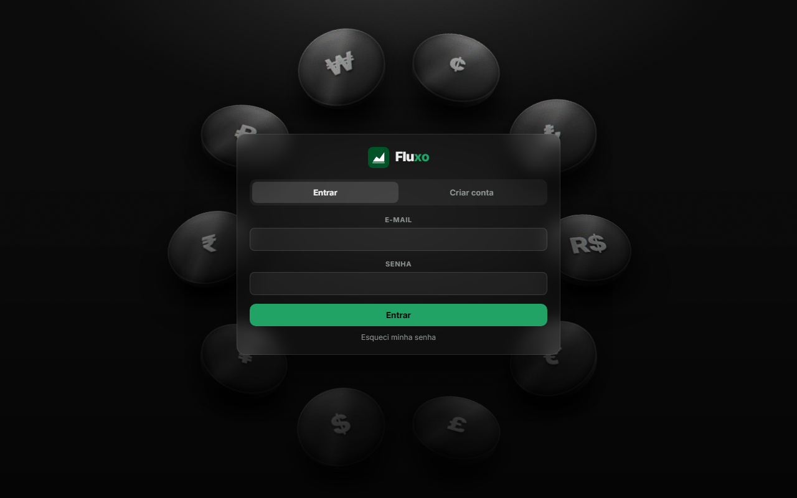
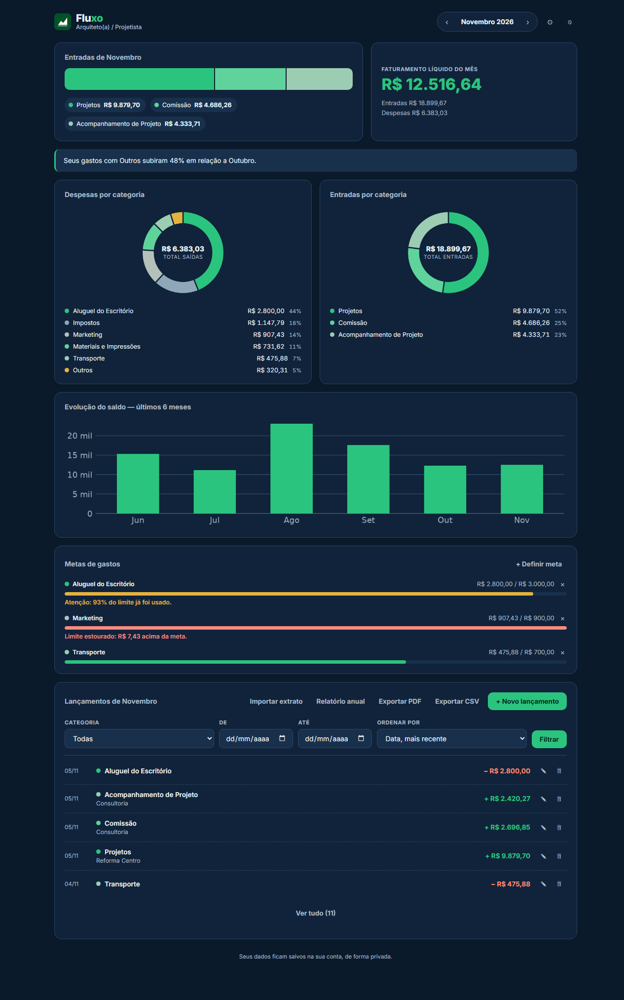
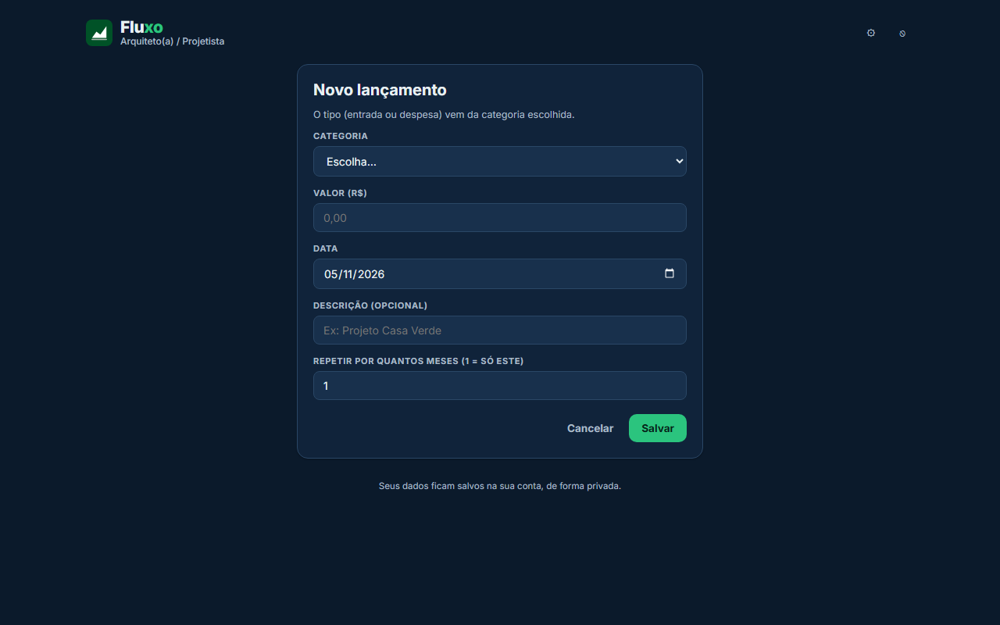
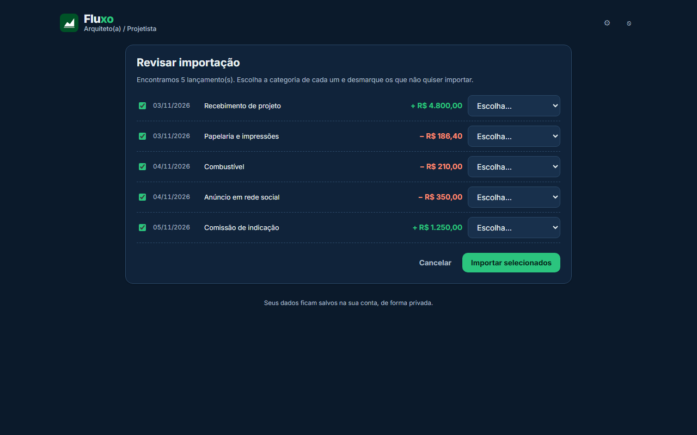
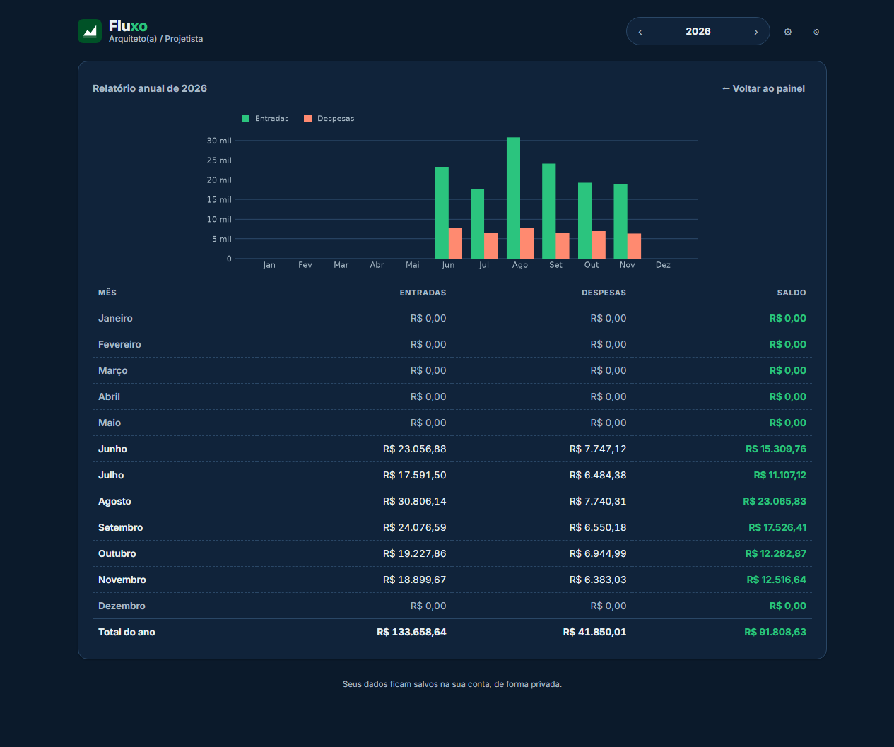

# Fluxo — controle financeiro

Sistema web de controle financeiro pessoal, para pessoas físicas, autônomos e
pequenos negócios, feito em **Python**. O servidor monta as telas, guarda os dados, desenha
os gráficos e gera o relatório em PDF.

## Tecnologias

| Camada | Ferramenta |
|---|---|
| Linguagem | Python 3.12 ou mais novo |
| Servidor web | Flask |
| Banco de dados | SQLite — arquivo local pelo módulo `sqlite3`; hospedado no Turso quando publicado |
| Telas | Jinja2 (sistema de templates do Flask) |
| Gráficos | matplotlib |
| Relatório em PDF | fpdf2 |
| Senhas | Werkzeug (hash com salt) |
| Aparência | CSS próprio, com modo escuro e claro, e fonte Inter (Google Fonts) |

Toda a lógica — login, cálculos, regras, importação de extrato e geração dos
gráficos e do PDF — roda em Python no servidor. O navegador recebe HTML e CSS já
prontos. O único JavaScript é o `confirm()` que pede confirmação antes de excluir.

## Como rodar

```bash
cd fluxo-python
python3 -m venv .venv
source .venv/bin/activate
pip install -r requirements.txt
python app.py
```

Depois abra <http://localhost:5001> no navegador (no macOS a porta 5000
costuma estar ocupada pelo AirPlay; para trocar, use `PORT=8000 python app.py`).

Na primeira execução o arquivo `fluxo.db` é criado sozinho, já com as tabelas.

## Estrutura

```
fluxo-python/
├── app.py           rotas: o que acontece em cada endereço do site
├── banco.py         todo o SQL; as outras partes nunca consultam direto
├── analise.py       cálculos: evolução do saldo e o comentário do mês
├── graficos.py      gráficos de rosca e de barras (matplotlib → PNG)
├── extrato.py       leitura de extratos bancários em CSV e OFX
├── relatorio.py     montagem do relatório em PDF
├── constantes.py    cores, meses, modelos de categorias, data no fuso do Brasil
├── preparar_nuvem.py  cria e confere as tabelas no banco hospedado
├── testar_fumaca.py   teste automático do sistema inteiro
├── dados_exemplo.py   preenche a conta de demonstração
├── docs/            banco de dados, plano de negócios e imagens das telas
├── templates/       as telas em HTML (Jinja2)
├── static/          folha de estilo e ícones
└── fluxo.db         banco de dados (criado ao rodar)
```

## Banco de dados

Cinco tabelas relacionadas:

- **usuarios** — conta de acesso (e-mail, senha com hash, nome do negócio)
- **categorias** — categorias de entrada e de despesa de cada usuário
- **lancamentos** — cada movimentação: valor, data, categoria e descrição
- **metas** — limite mensal de gasto por categoria
- **tokens_recuperacao** — pedidos de recuperação de senha: de quem é, quando expira e se já foi usado

As chaves estrangeiras estão ativas (`PRAGMA foreign_keys = ON`), e apagar
um usuário apaga em cascata tudo que é dele.

### Onde o banco fica

O banco é SQLite nos dois casos, com exatamente o mesmo SQL:

| Onde o sistema roda | Banco |
|---|---|
| No computador | arquivo `fluxo.db`, criado ao lado do código |
| Publicado na Vercel | o mesmo SQLite hospedado no Turso, acessado por HTTP |

A separação existe porque o servidor da Vercel não guarda arquivos: o disco é
descartado depois de cada requisição. Um `fluxo.db` dentro dele seria apagado
sozinho, levando os dados dos usuários. O `banco.py` escolhe um ou outro
conforme a variável `TURSO_DATABASE_URL` estar definida; as duas bibliotecas
seguem a mesma interface (DB-API 2.0), então nenhuma consulta muda.

## Funcionalidades

- Cadastro e login com senha protegida por hash
- Painel mensal: entradas, despesas, saldo e comentário automático
- Gráficos de rosca por categoria e evolução do saldo em 6 meses
- Lançamentos com repetição por vários meses
- Metas de gasto por categoria, com aviso em texto a partir de 80% e acima de 100%
- Importação de extrato bancário em CSV e OFX, com tela de revisão
- Relatório anual, relatório completo em PDF e exportação dos lançamentos em CSV
- Modelos de categorias para uso pessoal e para vários tipos de negócio
- Modo escuro, padrão do sistema, e modo claro, em Configurações

## Telas

As imagens abaixo usam só dados fictícios, da conta criada por
`python dados_exemplo.py`, no modo escuro.

### Login



### Painel



### Lançamento



### Importação de extrato



### Relatório anual



## Segurança

- As senhas nunca são guardadas em texto puro: o banco só tem o hash.
- Toda tela interna exige login (decorador `@exige_login`).
- Todas as consultas filtram pelo usuário da sessão, então um usuário não
  alcança os dados de outro.
- As consultas usam parâmetros (`?`), o que evita injeção de SQL.

## Publicar na internet

O sistema está no ar em <https://fluxo-python.vercel.app>, rodando na Vercel
com o banco hospedado no Turso.

A Vercel reconhece o Flask sozinha: acha a variável `app` dentro de `app.py`,
instala o `requirements.txt` e manda todas as rotas para lá. Não existe
arquivo de configuração; o `.python-version` só fixa o Python 3.12.

### Como foi montado

```bash
npx vercel login
npx vercel link --yes                                  # cria o projeto
npx vercel integration add tursocloud/database --name fluxo
```

A integração do Turso com a Vercel cria o banco e cadastra sozinha as
variáveis `TURSO_DATABASE_URL` e `TURSO_AUTH_TOKEN` no projeto, nos três
ambientes. Falta só a chave que assina o cookie de login:

```bash
python -c "import secrets; print(secrets.token_hex(32))" | npx vercel env add FLUXO_SEGREDO production
```

Sem `FLUXO_SEGREDO` o sistema se recusa a subir, de propósito: sem uma chave
fixa e secreta, qualquer pessoa poderia forjar a sessão de um usuário.

Depois, uma vez, para criar as tabelas no banco da nuvem:

```bash
npx vercel env pull            # traz as credenciais para .env.local
set -a; . ./.env.local; set +a
python preparar_nuvem.py
```

### Publicar uma nova versão

```bash
npx vercel deploy --prod
```

> O arquivo `.env.local` guarda o token do banco e está no `.gitignore`.
> Ele nunca deve ser enviado para o repositorio.

## Testes

O arquivo `testar_fumaca.py` percorre o sistema inteiro num banco temporário
— cadastro, login, lançamentos, edição, metas, gráficos, PDF, isolamento
entre contas, recuperação e troca de senha, exclusão de conta, exportação e tema:

```bash
python testar_fumaca.py
```
