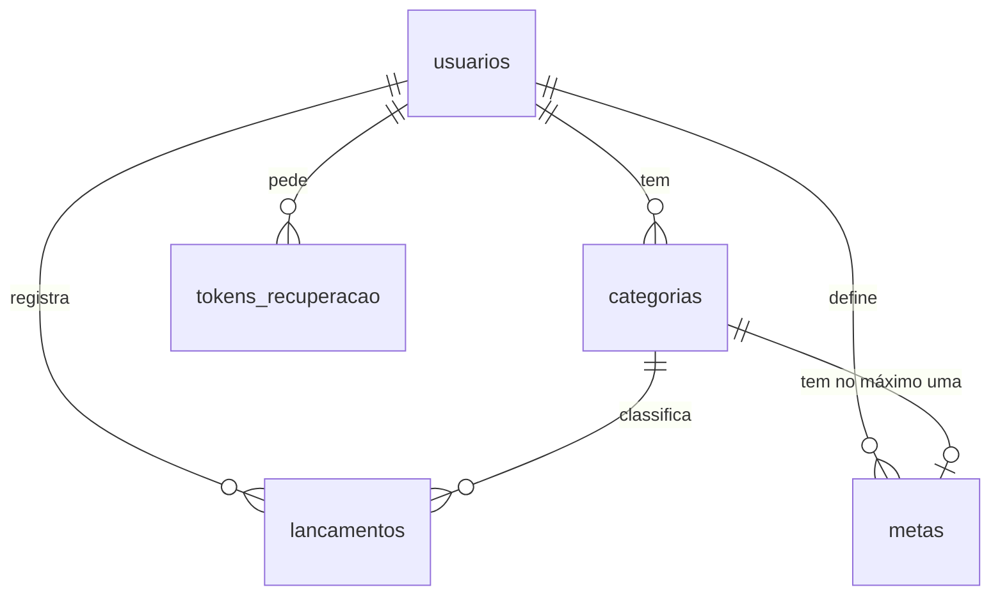

# Banco de dados do Fluxo

Este documento explica como os dados do Fluxo estão organizados e por que o
banco foi desenhado assim. A fonte de tudo o que está aqui é a variável
`ESQUEMA`, no começo do [`banco.py`](../banco.py): se os dois discordarem, vale
o código.

## Visão geral

O sistema usa **SQLite**, um banco relacional que guarda tudo em um único
arquivo e não precisa de um servidor próprio. O esquema tem cinco tabelas:

| Tabela | O que guarda |
|---|---|
| `usuarios` | a conta de acesso: e-mail, senha protegida e nome do negócio |
| `categorias` | as categorias de entrada e de despesa de cada usuário |
| `lancamentos` | cada movimentação: valor, data, tipo, categoria e descrição |
| `metas` | o limite mensal de gasto de uma categoria |
| `tokens_recuperacao` | os pedidos de recuperação de senha |

As quatro primeiras são o coração do sistema e estão detalhadas neste documento.
A `tokens_recuperacao` só apoia a recuperação de senha: guarda o hash do código
enviado no link, de quem é o pedido, quando expira e se já foi usado.



### Quem conversa com o banco

Dentro do sistema, quem conversa com o banco é só o `banco.py`. As rotas do
`app.py` e os cálculos do `analise.py` nunca escrevem SQL: chamam as funções
desse arquivo. Assim, toda consulta fica em um só lugar, sempre com parâmetros
`?` e sempre filtrando pelo usuário logado.

Os únicos outros arquivos que executam SQL não fazem parte do site em
funcionamento: o `preparar_nuvem.py`, que confere o banco hospedado antes de
publicar, e o `testar_fumaca.py`, que inspeciona o banco durante os testes.

### Onde o banco fica

O banco é SQLite nos dois casos, com exatamente o mesmo SQL:

| Onde o sistema roda | Onde os dados ficam |
|---|---|
| No computador de cada um | arquivo `fluxo.db`, criado ao lado do código na primeira execução |
| Publicado na Vercel | o mesmo SQLite, hospedado no Turso e acessado por HTTP |

O banco hospedado existe porque o servidor da Vercel não guarda arquivos: o
disco é descartado depois de cada requisição, e um `fluxo.db` ali seria apagado
junto com os dados dos usuários.

A escolha acontece na função `abrir_conexao()`: se a variável de ambiente
`TURSO_DATABASE_URL` estiver definida, a conexão vai para o Turso; se não, para
o arquivo local. As duas bibliotecas seguem a mesma interface (DB-API 2.0), então
nenhuma consulta muda. O `fluxo.db` é de cada máquina e não entra no repositório.

### Como ler as tabelas

- **Aceita vazio?** indica se a coluna aceita `NULL`, ou seja, ficar sem valor.
  Nenhuma coluna destas tabelas aceita: todas são `NOT NULL` ou chave primária.
- Texto em branco (`''`) é outra coisa: é um valor, e o `NOT NULL` não o barra.
  Se um campo não pode ficar em branco, essa conferência cabe à aplicação.
- O SQLite não tem um tipo próprio para datas. O Fluxo as guarda como `TEXT` no
  formato `AAAA-MM-DD`, em que a ordem alfabética coincide com a ordem do
  calendário. Por isso, comparar os textos é o mesmo que comparar as datas.

## Tabela `usuarios`

Uma linha para cada conta.

| Coluna | Tipo | Aceita vazio? | Para que serve |
|---|---|---|---|
| `id` | `INTEGER`, chave primária | não (gerado sozinho) | identifica a conta; é o que as outras tabelas referenciam |
| `email` | `TEXT`, `UNIQUE` | não | login do usuário |
| `senha_hash` | `TEXT` | não | resultado do hash da senha; nunca a senha em si |
| `nome_negocio` | `TEXT` | não (padrão `'Meu Negócio'`) | nome exibido no sistema; pode ser trocado depois |
| `criado_em` | `TEXT` | não | data do cadastro, no formato `AAAA-MM-DD` |

### Por que `email` é `UNIQUE`

O e-mail é o que identifica a pessoa na hora de entrar. Se duas contas pudessem
ter o mesmo e-mail, o login não saberia qual delas abrir, e um link de
recuperação de senha poderia ir para a conta errada.

A regra fica no banco, e não só no código, porque só o banco garante isso
sempre. Se duas pessoas enviarem o cadastro ao mesmo tempo, uma verificação feita
antes em Python poderia aprovar as duas; com o `UNIQUE`, a segunda gravação é
recusada. A função `criar_usuario()` trata esse erro e devolve `None`.

O `UNIQUE` diferencia maiúsculas de minúsculas: para o banco, `Ana@x.com` e
`ana@x.com` são textos diferentes. Por isso o `banco.py` converte o e-mail para
minúsculas (`email.strip().lower()`) antes de gravar e antes de procurar.

### Por que a senha é guardada como `senha_hash`

Um hash é uma transformação de mão única: da senha se calcula o hash, mas do hash
não se volta à senha. No login, o sistema calcula o hash do que foi digitado e
compara com o guardado, sem precisar saber a senha original. Quem faz isso é o
Werkzeug, com as funções `generate_password_hash` e `check_password_hash`.

Se a senha fosse guardada como texto, qualquer vazamento do banco, backup perdido
ou pessoa com acesso a ele veria as senhas de todos. E como muita gente repete a
mesma senha em vários lugares, o prejuízo iria além do Fluxo.

O valor guardado se parece com isto:

```text
scrypt:32768:8:1$kWhsf1619kykGYD...
```

Ele traz o algoritmo (`scrypt`), os parâmetros de custo e um *salt*, um valor
aleatório sorteado para cada senha. Por causa do salt, duas pessoas com a mesma
senha ficam com hashes diferentes, e quem invade o banco não descobre quem usa a
mesma senha nem aproveita uma tabela de hashes pronta. Como o `scrypt` é lento de
propósito, testar milhões de senhas também sai caro.

## Tabela `categorias`

Cada usuário tem as suas categorias, como "Aluguel" ou "Comissão". Elas nascem do
modelo de negócio escolhido em `aplicar_perfil()` e podem ser editadas depois.

| Coluna | Tipo | Aceita vazio? | Para que serve |
|---|---|---|---|
| `id` | `INTEGER`, chave primária | não (gerado sozinho) | identifica a categoria |
| `usuario_id` | `INTEGER`, chave estrangeira para `usuarios(id)` | não | de quem é a categoria |
| `tipo` | `TEXT`, com `CHECK` | não | `'entrada'` ou `'despesa'` |
| `nome` | `TEXT` | não | nome mostrado nas telas |
| `cor` | `TEXT` | não | cor em hexadecimal usada nos gráficos, como `#005227` |

O `usuario_id` faz com que uma pessoa renomeando "Transporte" não altere a
categoria de mais ninguém. Por isso as funções do `banco.py` sempre filtram por
ele: `WHERE id = ? AND usuario_id = ?`.

O `nome` não é `UNIQUE`: o banco deixa um usuário ter duas categorias com o mesmo
nome, e até trocar de modelo pode gerar repetição, porque `aplicar_perfil()` mantém
as categorias que já têm lançamentos.
