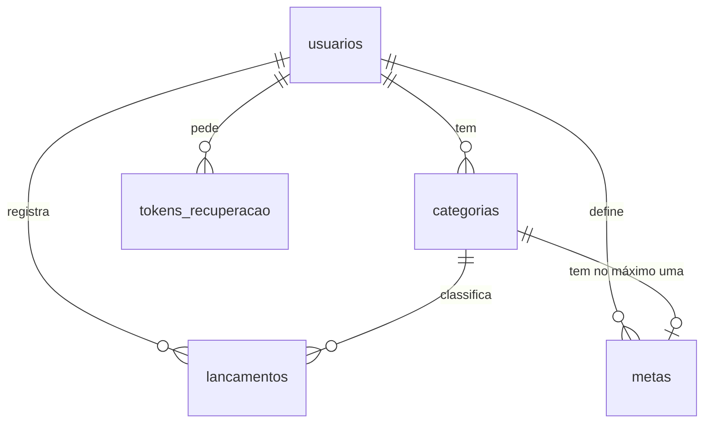

# Banco de dados do Fluxo

Este documento explica como os dados do Fluxo estão organizados e por que o
banco foi desenhado assim. A fonte de tudo o que está aqui é a variável
`ESQUEMA`, no começo do [`banco.py`](../banco.py): se os dois discordarem, vale
o código.

## Visão geral

O sistema usa **SQLite**, um banco relacional que guarda tudo em um único
arquivo e não precisa de um servidor próprio. O esquema tem cinco tabelas:

| Tabela | O que guarda |
|---|---|
| `usuarios` | a conta de acesso: e-mail, senha protegida e nome do negócio |
| `categorias` | as categorias de entrada e de despesa de cada usuário |
| `lancamentos` | cada movimentação: valor, data, tipo, categoria e descrição |
| `metas` | o limite mensal de gasto de uma categoria |
| `tokens_recuperacao` | os pedidos de recuperação de senha |

As quatro primeiras são o coração do sistema e estão detalhadas neste documento.
A `tokens_recuperacao` só apoia a recuperação de senha: guarda o hash do código
enviado no link, de quem é o pedido, quando expira e se já foi usado.



### Quem conversa com o banco

Dentro do sistema, quem conversa com o banco é só o `banco.py`. As rotas do
`app.py` e os cálculos do `analise.py` nunca escrevem SQL: chamam as funções
desse arquivo. Assim, toda consulta fica em um só lugar, sempre com parâmetros
`?` e sempre filtrando pelo usuário logado.

Os únicos outros arquivos que executam SQL não fazem parte do site em
funcionamento: o `preparar_nuvem.py`, que confere o banco hospedado antes de
publicar, e o `testar_fumaca.py`, que inspeciona o banco durante os testes.

### Onde o banco fica

O banco é SQLite nos dois casos, com exatamente o mesmo SQL:

| Onde o sistema roda | Onde os dados ficam |
|---|---|
| No computador de cada um | arquivo `fluxo.db`, criado ao lado do código na primeira execução |
| Publicado na Vercel | o mesmo SQLite, hospedado no Turso e acessado por HTTP |

O banco hospedado existe porque o servidor da Vercel não guarda arquivos: o
disco é descartado depois de cada requisição, e um `fluxo.db` ali seria apagado
junto com os dados dos usuários.

A escolha acontece na função `abrir_conexao()`: se a variável de ambiente
`TURSO_DATABASE_URL` estiver definida, a conexão vai para o Turso; se não, para
o arquivo local. As duas bibliotecas seguem a mesma interface (DB-API 2.0), então
nenhuma consulta muda. O `fluxo.db` é de cada máquina e não entra no repositório.

Nem tudo fica no banco: a escolha entre modo escuro e claro é guardada em um cookie,
porque vale para o navegador, não para os dados financeiros da conta.

### Como ler as tabelas

- **Aceita vazio?** indica se a coluna aceita `NULL`, ou seja, ficar sem valor.
  Nenhuma coluna destas tabelas aceita: todas são `NOT NULL` ou chave primária.
- Texto em branco (`''`) é outra coisa: é um valor, e o `NOT NULL` não o barra.
  Se um campo não pode ficar em branco, essa conferência cabe à aplicação.
- O SQLite não tem um tipo próprio para datas. O Fluxo as guarda como `TEXT` no
  formato `AAAA-MM-DD`, em que a ordem alfabética coincide com a ordem do
  calendário. Por isso, comparar os textos é o mesmo que comparar as datas.

## Tabela `usuarios`

Uma linha para cada conta.

| Coluna | Tipo | Aceita vazio? | Para que serve |
|---|---|---|---|
| `id` | `INTEGER`, chave primária | não (gerado sozinho) | identifica a conta; é o que as outras tabelas referenciam |
| `email` | `TEXT`, `UNIQUE` | não | login do usuário |
| `senha_hash` | `TEXT` | não | resultado do hash da senha; nunca a senha em si |
| `nome_negocio` | `TEXT` | não (padrão `'Meu Negócio'`) | nome exibido no sistema; pode ser trocado depois |
| `criado_em` | `TEXT` | não | data do cadastro, no formato `AAAA-MM-DD` |

### Por que `email` é `UNIQUE`

O e-mail é o que identifica a pessoa na hora de entrar. Se duas contas pudessem
ter o mesmo e-mail, o login não saberia qual delas abrir, e um link de
recuperação de senha poderia ir para a conta errada.

A regra fica no banco, e não só no código, porque só o banco garante isso
sempre. Se duas pessoas enviarem o cadastro ao mesmo tempo, uma verificação feita
antes em Python poderia aprovar as duas; com o `UNIQUE`, a segunda gravação é
recusada. A função `criar_usuario()` trata esse erro e devolve `None`.

O `UNIQUE` diferencia maiúsculas de minúsculas: para o banco, `Ana@x.com` e
`ana@x.com` são textos diferentes. Por isso o `banco.py` converte o e-mail para
minúsculas (`email.strip().lower()`) antes de gravar e antes de procurar.

### Por que a senha é guardada como `senha_hash`

Um hash é uma transformação de mão única: da senha se calcula o hash, mas do hash
não se volta à senha. No login, o sistema calcula o hash do que foi digitado e
compara com o guardado, sem precisar saber a senha original. Quem faz isso é o
Werkzeug, com as funções `generate_password_hash` e `check_password_hash`.

Se a senha fosse guardada como texto, qualquer vazamento do banco, backup perdido
ou pessoa com acesso a ele veria as senhas de todos. E como muita gente repete a
mesma senha em vários lugares, o prejuízo iria além do Fluxo.

O valor guardado se parece com isto:

```text
scrypt:32768:8:1$kWhsf1619kykGYD...
```

Ele traz o algoritmo (`scrypt`), os parâmetros de custo e um *salt*, um valor
aleatório sorteado para cada senha. Por causa do salt, duas pessoas com a mesma
senha ficam com hashes diferentes, e quem invade o banco não descobre quem usa a
mesma senha nem aproveita uma tabela de hashes pronta. Como o `scrypt` é lento de
propósito, testar milhões de senhas também sai caro.

## Tabela `categorias`

Cada usuário tem as suas categorias, como "Aluguel" ou "Comissão". Elas nascem do
modelo de negócio escolhido em `aplicar_perfil()` e podem ser editadas depois.

| Coluna | Tipo | Aceita vazio? | Para que serve |
|---|---|---|---|
| `id` | `INTEGER`, chave primária | não (gerado sozinho) | identifica a categoria |
| `usuario_id` | `INTEGER`, chave estrangeira para `usuarios(id)` | não | de quem é a categoria |
| `tipo` | `TEXT`, com `CHECK` | não | `'entrada'` ou `'despesa'` |
| `nome` | `TEXT` | não | nome mostrado nas telas |
| `cor` | `TEXT` | não | cor em hexadecimal usada nos gráficos, como `#005227` |

O `usuario_id` faz com que uma pessoa renomeando "Transporte" não altere a
categoria de mais ninguém. Por isso as funções do `banco.py` sempre filtram por
ele: `WHERE id = ? AND usuario_id = ?`.

O `nome` não é `UNIQUE`: o banco deixa um usuário ter duas categorias com o mesmo
nome. Ao trocar de modelo, `aplicar_perfil()` mantém as categorias que já têm
lançamentos e não cria outra com o mesmo tipo e nome.

## Tabela `lancamentos`

É a tabela principal: cada entrada ou despesa registrada vira uma linha.

| Coluna | Tipo | Aceita vazio? | Para que serve |
|---|---|---|---|
| `id` | `INTEGER`, chave primária | não (gerado sozinho) | identifica o lançamento |
| `usuario_id` | `INTEGER`, chave estrangeira para `usuarios(id)` | não | de quem é o lançamento |
| `categoria_id` | `INTEGER`, chave estrangeira para `categorias(id)` | não | em qual categoria ele entra |
| `tipo` | `TEXT`, com `CHECK` | não | `'entrada'` ou `'despesa'` |
| `valor` | `REAL`, com `CHECK` | não | quanto foi, sempre maior que zero |
| `data` | `TEXT` | não | dia da movimentação, no formato `AAAA-MM-DD` |
| `descricao` | `TEXT` | não (padrão `''`) | observação opcional; em branco quando não há |

### Por que guardar `usuario_id` e `tipo`, se a categoria já tem os dois?

Dava para descobrir o dono e o tipo de um lançamento olhando a categoria dele. Em
teoria, repetir essas colunas seria redundante. A repetição é de propósito, por
três motivos.

**1. As consultas mais usadas ficam em uma tabela só.** O painel soma as entradas
e as despesas do mês toda vez que abre. Com as colunas repetidas, `somar_mes()`
não precisa de `JOIN`:

```sql
SELECT COALESCE(SUM(valor), 0) AS total FROM lancamentos
WHERE usuario_id = ? AND tipo = ? AND data LIKE ?
```

Sem elas, toda soma teria de juntar duas tabelas para descobrir o dono e o tipo:

```sql
SELECT COALESCE(SUM(l.valor), 0) AS total
FROM lancamentos l JOIN categorias c ON c.id = l.categoria_id
WHERE c.usuario_id = ? AND c.tipo = ? AND l.data LIKE ?
```

O `somar_ano()` e a evolução do saldo aproveitam o mesmo atalho. Só entra `JOIN`
quando é preciso mostrar o nome ou a cor da categoria.

**2. O índice depende disso.** Um índice só cobre colunas de uma mesma tabela.
O `idx_lancamentos_usuario_data` (explicado mais adiante) só pode começar por
`usuario_id` porque essa coluna está em `lancamentos`.

**3. O passado não muda.** O `tipo` do lançamento registra o que ele era quando foi
gravado. Se uma categoria um dia mudasse de despesa para entrada e o tipo viesse
só dela, todos os lançamentos antigos mudariam de lado junto, e o saldo de meses
já fechados seria outro. Com a coluna própria, eles continuam como foram gravados.
Hoje nenhuma tela muda o tipo de uma categoria, mas o banco fica protegido se isso
vier a existir.

### O custo da repetição

Dado repetido pode ficar diferente, e o banco não impede isso. Ele aceita um
lançamento com tipo `'entrada'` em uma categoria de despesa, ou com o `usuario_id`
de uma pessoa e a categoria de outra, porque cada `REFERENCES` só confere se a
linha referenciada existe.

Quem garante a coerência é a aplicação. O tipo não é escolhido à mão: o `app.py`
busca a categoria com `buscar_categoria(usuario_id, categoria_id)`, que só a
encontra se for do usuário logado, e copia o tipo dela para o lançamento. Por
isso a regra de que tudo passa pelo `banco.py` e pelas rotas é importante.

## Tabela `metas`

Uma meta é o limite de gasto mensal de uma categoria. O sistema compara esse
limite com o que já foi gasto no mês e avisa a partir de 80% e acima de 100%.

| Coluna | Tipo | Aceita vazio? | Para que serve |
|---|---|---|---|
| `id` | `INTEGER`, chave primária | não (gerado sozinho) | identifica a meta |
| `usuario_id` | `INTEGER`, chave estrangeira para `usuarios(id)` | não | de quem é a meta |
| `categoria_id` | `INTEGER`, `UNIQUE`, chave estrangeira para `categorias(id)` | não | a categoria limitada |
| `valor_limite` | `REAL`, com `CHECK` | não | limite por mês, sempre maior que zero |

A tabela não guarda quanto já foi gasto. Esse valor é calculado a cada consulta em
`listar_metas()`, somando os lançamentos, e por isso nunca fica desatualizado. A
meta também não tem mês: o mesmo limite vale para todos os meses.

### Por que `categoria_id` é `UNIQUE`

O `UNIQUE` impede que a mesma categoria tenha duas metas. Sem ele, "Transporte"
poderia ter um limite de R$ 700 e outro de R$ 900 ao mesmo tempo. O painel
mostraria duas barras para a mesma categoria e não haveria como saber qual limite
vale.

Essa restrição também é o que faz `salvar_meta()` funcionar. A função usa
`ON CONFLICT(categoria_id) DO UPDATE`: se a categoria ainda não tem meta, cria; se
já tem, só troca o valor. O SQLite recusa esse comando quando a coluna não é
`UNIQUE`, então editar uma meta depende da restrição.

## Índice `idx_lancamentos_usuario_data`

```sql
CREATE INDEX IF NOT EXISTS idx_lancamentos_usuario_data
    ON lancamentos (usuario_id, data);
```

Um índice funciona como o índice de um livro: em vez de ler a tabela inteira, o
banco vai direto às linhas que interessam. Este existe porque quase toda tela
pergunta a mesma coisa: **os lançamentos de um usuário em um período**. É o caso
da lista do painel e do relatório anual:

```sql
SELECT ... FROM lancamentos
WHERE usuario_id = ? AND data BETWEEN ? AND ?
```

### Por que nessa ordem

O índice fica ordenado primeiro por usuário e, dentro de cada usuário, por data,
como uma lista telefônica ordenada por sobrenome e depois por nome. Assim, os
lançamentos de um usuário em um mês ficam todos vizinhos. O banco acha o começo do
trecho e lê até o fim do período.

A regra geral é colocar primeiro a coluna comparada com igualdade
(`usuario_id = ?`) e depois a comparada com intervalo (`data BETWEEN`). Na ordem inversa,
`(data, usuario_id)`, o banco percorreria os lançamentos de **todos** os usuários
naquele período para separar os de um só, e o trabalho cresceria junto com o
número de contas.

A ordem também define o que o índice não ajuda. Como ele começa por `usuario_id`,
uma busca só por data não consegue usá-lo. Isso não atrapalha, porque as consultas
de lançamentos do sistema sempre filtram por usuário.

### O que o `EXPLAIN QUERY PLAN` mostra

O comando `EXPLAIN QUERY PLAN` mostra como o SQLite vai executar uma consulta. Este
é o resultado com o esquema do `banco.py`, no SQLite 3.51:

| Consulta | Exemplo no código | Como o índice é usado |
|---|---|---|
| `usuario_id = ? AND data >= ? AND data <= ?` | `listar_lancamentos()` | usuário e intervalo de datas |
| `usuario_id = ? AND data BETWEEN ? AND ?` | `somar_ano()` | usuário e intervalo de datas |
| `usuario_id = ? AND data LIKE '2026-05%'` | `somar_mes()` | só o usuário |
| `data >= ?`, sem usuário | nenhum | não usa; lê a tabela inteira |

As consultas com `LIKE` só aproveitam a primeira coluna: o `LIKE` do SQLite ignora
maiúsculas e minúsculas por padrão e, por isso, não usa este índice para o intervalo
de datas. O banco lê então todos os lançamentos daquele usuário, mas não os das
outras contas.

## Chaves estrangeiras e restrições

As restrições abaixo são regras que o próprio banco faz valer. Mesmo que o código
tenha um erro, o dado inválido é recusado na hora de gravar. Os exemplos foram
testados com o `ESQUEMA` do `banco.py`.

### `REFERENCES usuarios(id) ON DELETE CASCADE`

`REFERENCES` diz que o valor precisa existir na outra tabela: não dá para gravar um
lançamento com `categoria_id = 999` se essa categoria não existe.
`ON DELETE CASCADE` acrescenta o que fazer quando a linha referenciada é apagada:
apagar junto as linhas que dependem dela.

**Ao apagar uma conta**, somem as categorias, os lançamentos, as metas e os tokens
dela. Partindo de uma conta com uma linha em cada tabela:

| Depois de `DELETE FROM usuarios` | `usuarios` | `categorias` | `lancamentos` | `metas` | `tokens_recuperacao` |
|---|---|---|---|---|---|
| Chaves estrangeiras ligadas | 0 | 0 | 0 | 0 | 0 |
| Chaves estrangeiras desligadas | 0 | 1 | 1 | 1 | 1 |

**Sem o cascade**, ficariam dados órfãos: valores e descrições financeiras de
alguém que pediu para sair, sem dono e sem nenhuma tela que os alcance.

Por garantia, a função `excluir_conta()` não depende só disso: ela apaga as tabelas
uma a uma, na mesma transação, e o `testar_fumaca.py` confere que nada sobra mesmo
com as chaves desligadas.

Nem toda chave estrangeira do esquema usa cascade, e a diferença é proposital:

| Referência | Ao apagar a categoria | Por quê |
|---|---|---|
| `metas.categoria_id` | a meta é apagada junto (`ON DELETE CASCADE`) | uma meta não faz sentido sem a sua categoria |
| `lancamentos.categoria_id` | o banco recusa com erro (sem `CASCADE`) | apagar a categoria não pode apagar o histórico financeiro |

A função `excluir_categoria()` confere isso antes e mostra uma mensagem pedindo que
os lançamentos sejam editados ou removidos primeiro.

### `CHECK (tipo IN ('entrada', 'despesa'))`

Impede qualquer outro valor nessa coluna, em `categorias` e em `lancamentos`. Uma
tentativa de gravar `'transferencia'` termina em erro:

```text
IntegrityError: CHECK constraint failed: tipo IN ('entrada', 'despesa')
```

**Sem o `CHECK`**, um valor como `'Despesa'` ou `'saida'`, vindo de um erro no
código, seria gravado sem aviso. Como `somar_mes()` e `somar_ano()` procuram
exatamente `'entrada'` e `'despesa'`, esse lançamento ficaria fora de todas as somas:
o dinheiro existiria no banco, mas não apareceria no saldo.

### `CHECK (valor > 0)`

Recusa valor negativo e também zero, que não representa nenhuma movimentação. A
tabela `metas` tem a regra equivalente em `CHECK (valor_limite > 0)`.

**O sinal fica no `tipo`, não no valor.** Toda despesa é gravada como um número
positivo com `tipo = 'despesa'`, e só existe uma forma de registrar cada coisa.

**Sem o `CHECK`**, a mesma despesa de R$ 100 poderia ser gravada como `100` ou como
`-100`, e as somas passariam a dar errado. O saldo é calculado em `resumo_do_mes()`,
no `analise.py`, como `entradas - despesas`: uma despesa de `-100` *aumentaria* o saldo em R$ 100. Um
gasto negativo também reduziria o total comparado com a meta, escondendo um estouro.

Extratos bancários costumam trazer as despesas com valor negativo. Por isso o
`extrato.py` converte na leitura: usa o sinal para sugerir o tipo e guarda o valor
absoluto (`abs(valor)`).

### `PRAGMA foreign_keys = ON`

No SQLite, as chaves estrangeiras vêm **desligadas** por padrão, para manter
compatibilidade com versões antigas. Sem esse comando, todo `REFERENCES` e todo
`ON DELETE CASCADE` do esquema seriam ignorados, e o banco aceitaria uma categoria
inexistente sem reclamar.

A configuração vale **por conexão**: não fica salva no arquivo. Toda conexão nova
começa desligada, mesmo que a anterior tenha ligado. Como o sistema abre uma conexão
a cada requisição, o comando precisa rodar todas as vezes. Se ele fosse executado só
ao criar as tabelas, por exemplo, nenhuma requisição teria a proteção.

Por isso ele fica dentro de `abrir_conexao()`, o único ponto por onde o sistema abre
conexões. No Turso, segundo o comentário nessa função, as chaves já vêm ligadas no
servidor; se o comando falhar lá, o erro é ignorado.
